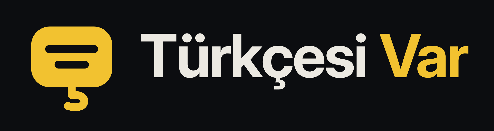
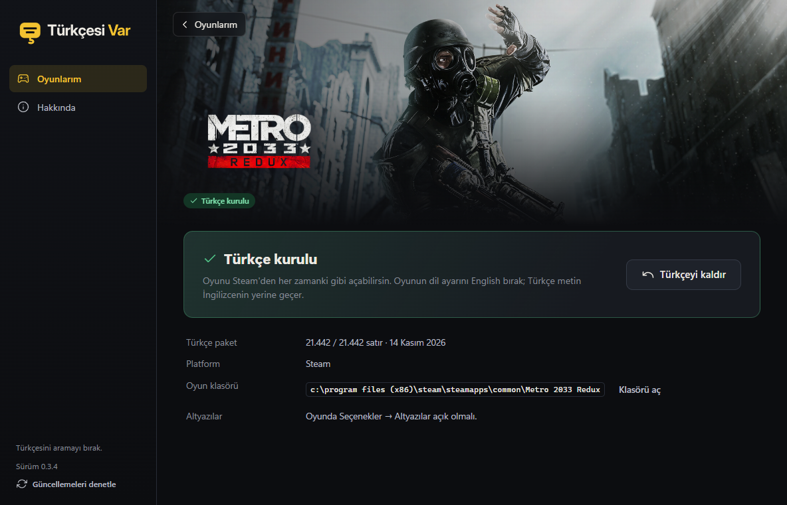

<p align="center">
  
</p>

<p align="center"><b>Oyunlara güvenli, ücretsiz Türkçe. Tek tıkla kur, tek tıkla kaldır.</b></p>

<p align="center">
  <a href="https://github.com/turkcesivar/turkcesi-var/releases/latest/download/TurkcesiVar-Kurulum.exe"><b>⬇ İndir (Windows)</b></a>
  &nbsp;·&nbsp;
  <a href="https://github.com/turkcesivar/turkcesi-var/releases/latest/download/TurkcesiVar-Kurulum.zip">ZIP olarak indir</a>
  &nbsp;·&nbsp;
  <a href="https://github.com/turkcesivar/turkcesi-var/issues/new?template=oyun-istegi.yml"><b>🎮 Oyun iste</b></a>
  &nbsp;·&nbsp;
  <a href="https://discord.gg/nnNUCMUBJx"><b>💬 Discord</b></a>
  &nbsp;·&nbsp;
  <a href="https://turkcesivar.github.io"><b>🌐 Web sitesi</b></a>
</p>

<p align="center">
  
</p>

---

> **Bir oyun düşün.** Yıllarca beklediğin, fragmanını ezberlediğin, çıktığı gün
> aldığın bir oyun. Dil seçeneklerine bakıyorsun: İngilizce, Fransızca,
> Almanca, İtalyanca, İspanyolca, Lehçe, Çekçe, Portekizce, Rusça, Japonca,
> Korece, Çince… Bir daha bakıyorsun. **Türkçe yok.**
>
> Milyonlarca Türk oyuncu her yıl bu oyunlara para veriyor. Şirketler on beş
> dil ekliyor, on altıncısına bir türlü sıra gelmiyor. Biz de ne yapıyoruz?
> Forum forum geziyoruz. "Türkçe yama var mı?" diye soruyoruz. Bulduğumuz
> dosyanın yarısı çalışmıyor, öbür yarısını antivirüs "trojan" diye yakalıyor.
> "Belki yanlış alarmdır" deyip riske giriyoruz, sonra oyun hiç açılmıyor.
>
> **Türkçesi Var bunu bitirmek için var.**
>
> - Kaynak kodu herkese açık. Ne yaptığını herkes görebilir.
> - Yamalar program değil, yalnızca Türkçe metin. İçinde virüs saklanacak yer yok.
> - Oyununa dokunmadan önce yedeğini alır. Beğenmezsen tek tıkla eski haline döner.
> - ğ, ş, ı, İ… Harflerimiz kare ya da soru işareti olarak çıkmaz.
> - Bir oyun bir kez çevrilir, herkes kullanır.
>
> Türkçesini aramayı bırak. **Türkçesi var.**

## Türkçesi hazır oyunlar

Güncel liste, oyun içi görüntüler ve hangi sürümlerin desteklendiği: **[turkcesivar.github.io/oyunlar](https://turkcesivar.github.io/oyunlar/)**

| Oyun | Kapsam | Durum |
|---|---|---|
| **Metro 2033 Redux** (Steam, Epic) | 21.442 satır çevrildi (iki Redux oyununun ortak metin tablosu): menüler, altyazılar, notlar, ipuçları | ✅ Hazır |
| **Metro Last Light Redux** (Steam) | 21.442 satır çevrildi (iki Redux oyununun ortak metin tablosu): menüler, altyazılar, görev defteri, ipuçları, silah ekranı | ✅ Hazır |
| **Metro Exodus Enhanced Edition** (Steam, Epic) | 37.652 satır: menüler, altyazılar, notlar, düşman konuşmaları, iki DLC (The Two Colonels, Sam's Story) | ✅ Hazır |
| **Metro Exodus** (normal sürüm, Steam) | Enhanced Edition ile aynı çeviri: menüler, altyazılar, notlar, iki DLC | ✅ Hazır |

Yeni oyunlar eklendikçe uygulama kendini günceller; ayrıca bir şey indirmen gerekmez.

### Hangi oyun çevrilsin?

Sıradaki oyunları sen seçiyorsun. [Oyun isteği formunu](https://github.com/turkcesivar/turkcesi-var/issues/new?template=oyun-istegi.yml)
doldur; oyun [zaten istenmişse](https://github.com/turkcesivar/turkcesi-var/issues?q=label%3A%22oyun+iste%C4%9Fi%22)
o kayda 👍 bırakman yeterli. GitHub hesabın yoksa [Discord sunucumuzdaki](https://discord.gg/nnNUCMUBJx) **oyun-istekleri**
kanalına yaz ya da var olan isteğe 👍 bırak. En çok istenen oyunlar önce çevrilir. (Hile koruması
olan çevrimiçi oyunlar güvenlik için çevrilmez.)

## Nasıl kullanılır?

1. [TurkcesiVar-Kurulum.exe](https://github.com/turkcesivar/turkcesi-var/releases/latest/download/TurkcesiVar-Kurulum.exe)
   dosyasını indir ve çalıştır (ZIP isteyen için: [TurkcesiVar-Kurulum.zip](https://github.com/turkcesivar/turkcesi-var/releases/latest/download/TurkcesiVar-Kurulum.zip);
   bütün sürümler: [Releases](https://github.com/turkcesivar/turkcesi-var/releases)). Yönetici izni istemez,
   masaüstüne kısayol koyar.
2. **Türkçesi Var**'ı aç. Steam kütüphanen kendiliğinden taranır; Türkçesi hazır oyunlar en üstte görünür.
3. Oyunu seç, **Türkçe yap**'a bas. Birkaç saniye sürer. Oyunu Steam'den her zamanki gibi aç.

Oyunu bulamazsa kartındaki **Klasörü seç** ile oyunun klasörünü göster. Uygulama hangi
dosyaların olduğu klasörü araman gerektiğini yazar (Metro 2033 Redux için `metro.exe`,
`content.vfx` ve `2033` klasörü; Metro Last Light Redux için `metro.exe`, `content.vfx` ve `outro_good.ogv`;
Metro Exodus için `MetroExodus.exe` ve `content.vfx`). Üst klasörü seçersen içinde kendisi arar.

Geri almak için aynı yerde **Türkçeyi kaldır**: oyun birebir eski haline döner.

Resimli anlatım: [Steam rehberi: Metro 2033 Redux'u tamamen Türkçe yapma](https://steamcommunity.com/sharedfiles/filedetails/?id=3839931588)

> **"Windows bilgisayarınızı korudu" uyarısı:** Uygulama henüz dijital imzalı olmadığı için
> Windows bu uyarıyı gösterebilir. *Ek bilgi → Yine de çalıştır* ile devam edebilirsin.
> Dosyanın resmi olduğundan emin olmak için sürüm notlarındaki SHA-256 özetini ve
> VirusTotal sonucunu karşılaştır.

## Güvenli mi?

- **Yedek alır.** Kurmadan önce değişecek oyun dosyalarının orijinallerini
  `%APPDATA%\turkcesi-var\yedekler` klasörüne kopyalar. Kaldırınca bunlar geri konur.
- **Program eklemez.** Oyuna DLL, enjektör ya da arka planda çalışan bir şey eklenmez;
  yalnızca oyunun kendi metin ve yazı tipi dosyaları değişir.
- **Hile korumalı oyunlara dokunmaz.** Çevrimiçi, hile korumalı oyunlarda dosya değiştirmek
  hesap yasağına yol açabileceği için bu oyunlar hiçbir zaman değiştirilmez.
- **Kayıtlarına dokunmaz.** Oyun kayıtların Steam'in kendi klasöründedir; Türkçe kurup
  kaldırmak onları etkilemez.
- **Açık kaynak.** Uygulamanın ne yaptığını bu depoda satır satır görebilirsin.
- **Virüs taraması temiz.** 0.6.1 kurulum dosyası [VirusTotal'da 0/66](https://www.virustotal.com/gui/file/11f18389391760e51e58a85116a70d8be100d3905d26c25c22f34769d94961fa): hiçbir antivirüs işaretlemedi.

## Güncellemeler

- **Oyun güncellenirse:** Steam bir oyunu güncellediğinde Türkçe yama devre dışı kalır ve oyun
  İngilizce açılır. Türkçesi Var'ı açman yeter; durumu fark eder ve Türkçeyi yeni sürüme
  kendiliğinden yeniden kurar.
- **Uygulama güncellenirse:** Yeni sürüm çıktığında uygulama "Güncelleme var" der. Sen *İndir*
  deyince indirir (*Sonra* dersen hiçbir şey inmez); *Yeniden başlat ve güncelle* ile birkaç saniyede kurulur.
- **Çeviri düzeltilirse:** Yeni sürüm düzeltilmiş çeviriler getirdiyse, uygulamayı açtığında
  oyundaki Türkçe de kendiliğinden yenilenir.

## Sık sorulanlar

**Oyunda hangi dili seçmeliyim?**
English. Türkçe metin İngilizcenin yerine geçer. Altyazıları görmek için oyun ayarlarında
altyazıları aç.

**Steam dışından kurduğum oyunda çalışır mı?**
Oyun Türkçesi hazır oyunlardan biriyse **Klasörü seç** ile klasörünü göster. Uygulama doğru
dosyaları bulursa kurar.

**Çeviriler nasıl yapıldı?**
Yapay zekâ yardımıyla, oyundaki seslendirmeyle uyumlu olacak biçimde
çevrildi; özel adlar ve terimler için ortak bir sözlük kullanıldı. Hatalı ya da garip bir
satır görürsen lütfen bildir.

**Türkçesi Var'ı kaldırırsam oyun eski hâline döner mi?**
Hayır. Uygulamayı Windows'tan kaldırmak oyundaki Türkçeyi kaldırmaz. Önce uygulamada
**Türkçeyi kaldır**'a bas, sonra uygulamayı kaldır. (Yedekler `%APPDATA%\turkcesi-var` içinde
kalır; uygulamayı yeniden kurarsan oradan geri alabilirsin.)

**Oyun klasörünü taşırsam ne olur?**
Uygulamayı açıp **Yenile**'ye bas; yedek yeni yerde de tanınır, Türkçeyi kaldırabilir ya da yeniden kurabilirsin.

**Ücretli mi?**
Hayır. Türkçesi Var ücretsizdir ve öyle kalacak. Katkı vermek istersen: [Destek ol](#-destek-ol).

## Çeviri hatası bildir

[Çeviri hatası formunu](https://github.com/turkcesivar/turkcesi-var/issues/new?template=ceviri-hatasi.yml) doldur. Form şunları sorar:
oyunun adı, satırın oyundaki yeri (bölüm, menü, ipucu…), şu anki Türkçe metin ve önerin.
GitHub hesabın yoksa [Discord sunucumuzdaki](https://discord.gg/nnNUCMUBJx) **çeviri-hataları** kanalına ekran görüntüsüyle yaz.
Düzeltmeler bir sonraki sürümle herkese gelir.

## 💛 Destek ol

Türkçesi Var **ücretsiz** ve öyle kalacak: reklam yok, ücretli sürüm yok, çeviriler parayla satılmıyor.

Ama her yeni oyunun bir maliyeti var:

- **Çeviri:** Her oyunun binlerce satırı yapay zekâ servisleriyle çevriliyor; bu servisler ücretli
  ve maliyet oyunun büyüklüğüyle artıyor.
- **Emek:** Her oyun motorunun dosya biçimini çözmek, Türkçe harfleri (ğ, ş, ı, İ) oyunun kendi yazı
  tipine eklemek ve oyunda baştan sona denemek günler sürüyor.
- **Güven:** Windows'un "Bilgisayarınız korundu" uyarısını kaldırmak için yıllık ücretli bir dijital
  imza sertifikası gerekiyor.

Desteğin doğrudan bunlara gidiyor: daha çok oyun, daha hızlı. Küçük bir destek bile sıradaki
oyunun Türkçeye kavuşmasını hızlandırır.

**[💛 Türkçesi Var'a destek ol](https://kreosus.com/turkcesivar)**

Destek olamıyorsan da sorun değil: uygulamayı arkadaşlarınla paylaşmak, [oyun istemek](https://github.com/turkcesivar/turkcesi-var/issues/new?template=oyun-istegi.yml)
ve [çeviri hatalarını bildirmek](https://github.com/turkcesivar/turkcesi-var/issues/new?template=ceviri-hatasi.yml) de büyük destek.

## Lisans

| Kısım | Lisans |
|---|---|
| Kaynak kodu | [GNU GPL v3.0](LICENSE) ve [ek şartlar](EK-SARTLAR.md) |
| Türkçe çeviri paketleri (`paketler/`) | [CC BY-NC-ND 4.0](paketler/LICENSE) |
| "Türkçesi Var" adı ve logosu | Lisansa dahil değildir, bkz. [MARKA.md](MARKA.md) |

Kısaca: kodu inceleyebilir, öğrenebilir, değiştirebilirsin. Değiştirdiğin sürümü
paylaşırsan **farklı bir ad ve logo** kullanmalı, orijinaline atıf yapmalı ve kaynak kodunu
açmalısın. Çeviriler değiştirilemez ve başka bir uygulamada dağıtılamaz. Ayrıntılar
[EK-SARTLAR.md](EK-SARTLAR.md) dosyasında.

Oyunlar, oyun metinleri ve dosyaları yapımcılarına aittir; bu depoda bulunmaz.
Türkçesi Var bu oyunların yapımcılarıyla bağlantılı değildir.

Resmi sürümler **yalnızca** [github.com/turkcesivar/turkcesi-var/releases](https://github.com/turkcesivar/turkcesi-var/releases)
adresinden yayımlanır.

---

<details>
<summary><b>Geliştiriciler için</b></summary>

Electron 45 + React 19 + TypeScript; testler Vitest.

```
npm install
npm test               # testler
npm run uygulama       # geliştirme kipi
npm run exe            # dist\<sürüm>\TurkcesiVar-Kurulum.exe (+ .zip)
```

| Klasör | İçerik |
|---|---|
| `src/motorlar/4a/` | 4A Engine (Metro) dosya biçimleri: dizin, paketler, metin tablosu, yazı tipleri |
| `src/ortak/yedek.ts` | Oyun klasörüne yazan **tek** yer: yedek, hep-ya-da-hiç yazma, geri alma |
| `src/oyunlar/` | Desteklenen oyun tanımları, Steam taraması, elle klasör tanıma |
| `src/servis/` | Arayüzün kullandığı servis ve arka plan iş parçacığı |
| `uygulama/` | Electron ana süreç, güvenli köprü ve arayüz |
| `paketler/` | Uygulamayla gelen Türkçe paketler (CC BY-NC-ND 4.0) |
| `docs/notlar/` | Dosya biçimlerinin çözümü ve çalışma notları |

</details>
